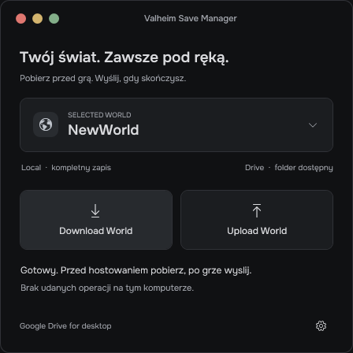

# Valheim Save Manager

**Wspólny świat Valheim, bez przesyłania ZIP-ów na czacie.**

Mała aplikacja Windows do ręcznej wymiany zapisu świata przez folder Google Drive for desktop. Przed hostowaniem pobierasz świat, a po zakończeniu gry wysyłasz nową wersję. Znajomy korzysta z tego samego folderu Drive i pobiera zapis przed swoją sesją.

Interfejs WPF jest ciemny i używa dołączonej czcionki **Onest**. Aplikacja działa lokalnie, bez serwera i bez integracji z Google Drive API.

<p align="center">
  
</p>

> **Stan projektu:** wczesna wersja open source. Silnik i GUI przetestowano na sztucznych światach w Windows PowerShell 5.1. Test prawdziwego świata w grze oraz wymiana przez chmurę między komputerami pozostają do wykonania. Przed pierwszym użyciem zachowaj niezależną kopię swojego świata.

## Do czego to służy?

Chcecie grać na jednym świecie, ale raz hostuje jedna osoba, a raz druga. Zamiast za każdym razem ręcznie szukać plików, pakować zapis i przesyłać go znajomemu, aplikacja robi to przez wspólny folder Drive.

| Przycisk | Co robi |
|---|---|
| **Download World** | Sprawdza najnowszy ZIP ze wspólnego folderu, tworzy backup lokalnego świata i importuje zapis po Twoim potwierdzeniu. |
| **Upload World** | Pakuje cały lokalny folder wybranego świata, sprawdza archiwum i umieszcza nowy ZIP w folderze Drive. |
| **Karta świata / Settings** | Zmienia nazwę świata i lokalizację Drive, pokazuje lokalną ścieżkę oraz pozwala otworzyć backupy. |

Aplikacja synchronizuje **wyłącznie wybrany świat**. Nie przenosi postaci i nie uruchamia gry ani serwera. Nie łączy dwóch niezależnie rozegranych wersji świata.

## Wymagania

- Windows z Windows PowerShell **5.1** i .NET Framework/WPF.
- Google Drive for desktop oraz wspólny folder z uprawnieniami do edycji, widoczny lokalnie na każdym komputerze.
- Zapis świata przeniesiony w Valheim do **Local / Move to Local**.
- Folderowy zapis zawierający pliki `_main.N.ok`, `_main.N.db2`, `_main.N.fwl2`, `_main.N.chunks` z tej samej generacji. Starszy płaski format `.db/.fwl` nie jest obsługiwany.

## Instalacja i pierwszy start

1. W tym repozytorium wybierz **Code → Download ZIP** i wypakuj **cały folder**. Nie uruchamiaj plików bezpośrednio z ZIP-a.
2. Uruchom dwuklikiem **`Uruchom-Valheim-Save-Manager.cmd`**. Nie wymaga uprawnień administratora.
3. Kliknij kartę świata albo ikonę ustawień.
4. Wpisz dokładną nazwę lokalnego folderu świata i wskaż wspólny folder Drive. Każdy komputer może mieć inną ścieżkę lub literę dysku.
5. Zapisz ustawienia. Sprawdź status lokalnego świata i dostępność folderu Drive.

Domyślnie wybrany jest `NewWorld`, a przykładowy folder Drive to `G:\Mój dysk\VALHEIM`. Zmień je w Settings, jeśli u Ciebie są inne.

Launcher korzysta z Windows Script Host, aby ukryć konsolę PowerShell. Samo okno CMD może mignąć przy dwukliku. Bezpośrednio można uruchomić `Start-ValheimSaveManager.vbs`; opcjonalna wersja konsolowa to `Uruchom-Konsole.cmd`. Polityki firmowe mogą blokować PowerShell lub WScript — aplikacja nie zmienia ustawień zabezpieczeń Windows.

## Jak grać na zmianę

### Pierwsze udostępnienie

Osoba posiadająca kompletny świat zamyka Valheim i serwer, wybiera **Upload World**, a następnie czeka, aż Google Drive zakończy synchronizację. Druga osoba może dopiero wtedy pobrać zapis.

### Kolejne sesje

1. Ustalcie, kto będzie hostować. **Nie hostujcie tego samego świata jednocześnie.**
2. Poczekaj na synchronizację folderu Google Drive.
3. Przy zamkniętej grze wybierz **Download World** i potwierdź podmianę.
4. Uruchom Valheim i zagraj.
5. Po grze zamknij Valheim oraz ewentualny serwer.
6. Wybierz **Upload World** i poczekaj na zakończenie synchronizacji w Google Drive for desktop.

**Komunikat o utworzeniu ZIP-a oznacza tylko, że plik trafił do lokalnego folderu Drive.** Aplikacja nie potwierdza wysłania do chmury ani dostarczenia pliku znajomemu.

## Co chroni zapis

- Synchronizacja jest blokowana, gdy działa `valheim` lub `valheim_server`.
- Sam folder `cacheMinimap` nie jest uznawany za zapis świata.
- Upload jest blokowany, gdy na Drive znajduje się wersja niepobrana na tym komputerze lub lokalne pliki są starsze od znanego archiwum.
- Download różniącego się świata jest blokowany, jeśli lokalny zapis jest nowszy od archiwum. Nie ma przycisku wymuszającego cofnięcie postępu.
- ZIP jest sprawdzany przed importem: manifest, świat, ścieżki, komplet plików i CRC32. Niebezpieczne ścieżki i dane spoza wybranego świata są odrzucane.
- Przed podmianą powstaje pełny staging oraz backup weryfikowany hashami SHA-256. Dopiero potem następuje podmiana katalogu.
- Błąd importu uruchamia rollback. Dziennik transakcji pozwala odzyskać poprzedni stan przy następnej operacji po przerwanym imporcie.
- Operacje działają w tle. Przyciski i zamknięcie okna są blokowane na czas pracy. Pasek aktywności nie pokazuje wymyślonych procentów.

Nowszy, uszkodzony ZIP blokuje import; aplikacja nie wybiera po cichu starszego archiwum. Nie usuwaj stanu programu, żeby obejść konflikt wersji — najpierw ustalcie, kto posiada aktualny świat.

## Gdzie są pliki?

| Dane | Lokalizacja |
|---|---|
| Wybrany świat | `%USERPROFILE%\AppData\LocalLow\IronGate\Valheim\worlds_local\<nazwa świata>` |
| Ustawienia JSON | `%LOCALAPPDATA%\ValheimSaveManager\config.json` |
| Backupy przed importem | `%LOCALAPPDATA%\ValheimSaveManager\Backups` |
| Stan ostatniego archiwum | `%LOCALAPPDATA%\ValheimSaveManager\state_<świat>.json` |
| Historia ostatniej próby i sukcesu | `%LOCALAPPDATA%\ValheimSaveManager\history_<świat>.json` |
| Archiwa ZIP | Wybrany przez Ciebie wspólny folder Drive |

Każdy upload tworzy nowy ZIP. Backupy i stare archiwa nie są automatycznie usuwane. Zostaw wolne miejsce na rozpakowany świat, staging, ZIP i backup.

Stary config z samym `driveFolder` jest odczytywany; brakująca nazwa świata przyjmuje `NewWorld`. Błędny JSON powoduje jawny błąd, zamiast cichej zmiany ustawień.

## Najczęstsze problemy

| Problem | Co sprawdzić |
|---|---|
| Brak kompletnego świata | Czy wybrano właściwą nazwę i **Move to Local**? `cacheMinimap` nie wystarczy. |
| Folder Drive niedostępny | Czy Google Drive for desktop działa, folder jest udostępniony i ścieżka w Settings jest poprawna? |
| Drive zawiera niepobraną wersję | Ustalcie ostatniego hosta, poczekajcie na Drive i pobierzcie aktualny świat. |
| Lokalny świat jest nowszy | Import cofający postęp został zablokowany. Zachowaj obie wersje i ustal, która jest właściwa. |
| Synchronizacja zablokowana przez grę | Zamknij Valheim i serwer przed ponowieniem operacji. |
| Błędny ZIP lub CRC32 | Poczekaj na synchronizację Drive. Zachowaj archiwum i sprawdź źródło; nie wymuszaj importu. |
| Błędny config JSON | Zachowaj kopię pliku, popraw JSON albo zmień jego nazwę, a następnie skonfiguruj aplikację ponownie. Nie usuwaj zapisów ani backupów. |

## Ograniczenia

To ręczna wymiana zapisów przez lokalny folder. Nie ma blokady między komputerami, potwierdzenia chmury ani scalania rozbieżnych sesji. Poprawna kolejność hostowania i pełna synchronizacja Drive są konieczne.

Kontrola kompletności jest strukturalna; aplikacja nie parsuje binarnego formatu Valheim. Porównanie wieku zależy od zegarów komputerów. Nie obsługujemy dowiązań, archiwów wieloczęściowych i starego płaskiego formatu świata. ZIP64 ma obsługę w kodzie, ale rzeczywisty ZIP ponad 4 GB nie został przetestowany. Backup na tym samym komputerze nie chroni przed awarią całego dysku.

## Kod i testy

```text
ValheimSaveManager.ps1             GUI i adapter konsolowy
Uruchom-Valheim-Save-Manager.cmd    start GUI
Start-ValheimSaveManager.vbs       ukrycie konsoli PowerShell
Uruchom-Konsole.cmd                opcjonalne menu konsolowe
ui/Main.xaml                      wygląd aplikacji
engine/Sync.ps1                    wspólny silnik synchronizacji
engine/ZipIntegrity.cs             kontrola CRC32
config/default.json               przykładowe ustawienia
assets/fonts/                     Onest i jego licencja
tests/                            testy silnika, WPF i launcherów
docs/                             opis mechanizmu, testy i podglądy
```

Testy uruchamiaj z katalogu projektu w Windows:

```powershell
powershell.exe -NoProfile -ExecutionPolicy Bypass -File .\tests\Test-Engine.ps1
powershell.exe -NoProfile -STA -ExecutionPolicy Bypass -File .\tests\Test-Gui.ps1 -Launcher
```

Testy silnika używają unikalnego katalogu tymczasowego. Testy GUI tworzą izolowaną kopię aplikacji i sztuczny świat, a zapytanie o uruchomioną grę mockują tylko w tej kopii. Produkcyjny kod zachowuje blokadę gry. Wyniki i fixture'y GUI są w ignorowanym `test-results/`.

Udokumentowany wynik: **23 testy silnika i 22 kontrole WPF** na Windows PowerShell 5.1. To wyniki lokalne; szczegóły oraz pozostałe testy ręczne są w [docs/TESTS.md](docs/TESTS.md). Mechanizm opisano w [docs/ARCHITECTURE.md](docs/ARCHITECTURE.md).

## Licencja

Kod: **[MIT](LICENSE)**. Czcionka Onest: **[SIL Open Font License 1.1](assets/fonts/OFL.txt)**; [źródło fontu](https://github.com/google/fonts/tree/main/ofl/onest).

Projekt jest niezależnym narzędziem społecznościowym. Nie jest oficjalnym produktem Valheim, Iron Gate ani Google.
